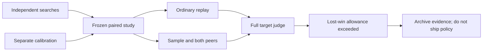

## Summary

Completed the calibrated paired replay study. All three independent discovery
runs reached the predeclared **remove** decision because the sample/peer policy
lost target-confirmed wins. This PR preserves registration, calibration, aggregate
results and reproduction instructions, with a neutral receipt auditor and report
regressions. The rejected runtime policy is confined to archived source; runtime
sources match Develop. Closes #140.

## Spec

### Intent and Rationale

- Test whether exact failure reuse and cross-lineage screening repay their costs before shipping an optional policy.
- Use real regression data and genuinely searched independent histories; the earlier synthetic smoke execution could establish correctness, not optimisation benefit.

### Essential Design Decisions

- Freeze settings, candidate order, sample membership, versions, immutable parents and equal upper compute limits before validation. Three independent discovery runs contain 24 sample-seed pairs, not 24 independent searches.
- Apply the registered zero-lost-win allowance. Removal follows deterministic lost wins in every run; shared-host timing differences alone do not establish the negative finding.
- Keep raw corpora, snapshots, source receipts, path-bearing manifests and ledgers outside the public tree. Publish aggregate outcomes and cryptographic commitments.
- Preserve unknown measurements: run three has no assisted full-target measurement, so its rate is null and excluded from rate uncertainty. The study concerns a fixed finite candidate stream, not adaptive discovery at matched consumed compute.

### Undiscoverable Facts

- Inspected source/test trees and working artefact directories supplied no usable production corpus paired with independent ancestry archives; twelve independent seeded searches were produced instead.
- Native scorer source was `742c5df30fc98ece3afe784be1aca18f925b47b3`; both tools used dev builds on shared host `vibe-coder-65826`. Validation completed on 14 November 2026, 02:49 UTC.
- The checkpointed policy and input preparer remain reproducible at `7b26468e8e70af8597811bef14d6fe1a26e5f683`; they were withdrawn from this branch after the registered removal trigger. The earlier smoke archives remain historical evidence.
- The research checksum identifies previously reviewed tool-extracted text of `2610.05950v1`, not original HTML/PDF bytes; direct downloads returned HTTP 403.

## Evidence

Backend/CLI research only; no visual surface changed. The final diff adds study
records and neutral analysis tooling using the Python standard library. Runtime
sources match Develop.

The receipt auditor now requires exactly one pair for each frozen protocol seed
before processing a run, rejecting missing, duplicate and unexpected seeds. It
also requires allocated outer-inclusive costs to reconcile with the complete
comparison window within one microsecond before exporting any report.

- `docs/experiments/ledger-140-preregistration.json` was committed before calibration; `docs/experiments/ledger-140-calibration-lock.json` before validation. Separate calibration selected 128 records and a 0.01 margin, with four calibration wins and zero false rejections across the calibration seeds.
- `docs/experiments/ledger-140-real-data-results.json` contains 24 paired distributions, input/lineage/payload commitments, stage losses, uncertainty, coverage, failures and outer-inclusive accounting. All 72 accepted ancestry edges replayed through the ordinary CLI; twelve complete ancestry lists are disjoint.
- All three runs completed with zero operational failures or interruptions. The policy avoided 957 repeated failed stage evaluations but lost 42 paired control-confirmed patch observations: 40 at peer gates and two at sample gates. Control confirmed seven distinct winning identities across runs; the policy confirmed two, transferable to both peers and the target.
- Control used 1,152 scorer calls and 1,152 full target evaluations; the assisted arm used 2,007 calls and 28 full target evaluations. Workflow coverage was complete in both arms. Outer-inclusive totals were 244.101 and 259.583 seconds, including shared setup/search/calibration, inter-command preparation and complete freeze/run command costs; timings are indicative.

The exact descriptive interval across the two measured independent-run mean rate
differences is `[-2.74753, -0.33600]` score gain/hour; the third run's rate remains
unknown. Across all three runs the lost-win mean per sample pair has descriptive
interval `[0.125, 3.125]`. One dataset and three shallow custom discovery runs do
not establish production-scale or cross-application effect sizes.

`docs/ledger-experiment.md` documents method reconciliation, input preparation,
calibration, maintenance action, accounting boundaries and archived-source
commands. `docs/experiments/ledger-140-availability.json` now records the completed
study. README's Quick start examples and Documentation table point to that record.

Issue provenance: #140 — Experiment: Replayable experiment ledger and cross-lineage promotion.

## Test Plan

- Passed `timeout 20 python3 -B scripts/test_ledger_study_evidence.py < /dev/null`: 15 tests. `BootstrapTests.test_two_run_interval_keeps_both_empirical_tails` and `test_three_run_interval_keeps_extreme_resamples` first failed under the initial new report calculation, then passed with inverse empirical CDF endpoints. `test_unreplicated_or_missing_rates_have_no_interval` preserves absent uncertainty. The five `AccountingTests` cases protect inter-command preparation charging, a contiguous window, inconsistent clocks, invalid costs and a missing start timestamp. Seven `ReceiptCliTests` exercise the actual auditor command with self-contained receipts and a replay executable double: complete/reordered seeds reconcile to the window; missing, empty, duplicate, replacement-duplicate and unexpected seed sets, plus inconsistent shared costs, fail without creating output. All six negative CLI regressions failed before this fix and pass at head. This is new report coverage, not a claim of a base-branch defect.
- Passed the actual `scripts/ledger-study-evidence.py` command against retained study artefacts. It verified frozen input hashes and native source deltas, dry-replayed accepted ancestry, checked disjoint histories and complete failure-free paired coverage, and generated the committed aggregate report. A real final-snapshot check returned CLI exit 3 with `nothingToDo`; the auditor handles that specific expected outcome.
- Reproduced verifier item 1 before fixing it: removing run 1's seed 48 pair still exported a report with pair counts `[7, 8, 8]` and only 487.814059 seconds allocated against the 503.683989-second window. After the fix, copies with missing, duplicate or unexpected seeds exit unsuccessfully and create no report. Complete retained receipts still produce `[8, 8, 8]`, allocate exactly 503.683989 seconds, and reproduce the committed aggregate apart from audit elapsed time.
- Passed `timeout 1200 ./quality.sh < /dev/null`: Bash syntax, ShellCheck, runlib contract, actionlint, cargo-deny, formatting, Clippy, workspace tests and documentation build. Disk checks showed about 487 GiB workspace and 495 GiB Cargo-target free; no budget refusal file was present.
- Existing `rebase/tests/race_conditions.rs` (15 tests) and `rebase/tests/screen_budget.rs` (five tests) passed both targeted execution and the final full gate. No Develop test assertion was changed or removed. The checkpoint-only 16-test experiment suite passed before its runtime and fixture were retired; it is historical coverage, not a test suite shipped at head.
- Passed `timeout 60 markdownlint-cli2 README.md docs/ledger-experiment.md < /dev/null`: ten Markdown files, zero issues. Re-read the protocol through reproduction and limitations, and swept README/docs/source for retired example/interface names and stale availability claims; surviving example references explicitly concern the archived pin.
- Three completed historical restarts returned unchanged ledger hashes and no new scorer calls. No acceptance-gate repair was necessary. Whole-window reconciliation first failed with 59.710 seconds uncharged; after adding inter-command preparation, the public totals equal the observed 503.684-second setup-through-validation window. The report charges that gap and outer command residuals without altering frozen native evidence. Shared rule copies: none remain for the removed policy; the report has one bootstrap implementation called by its tests and real report path.

Security check: local CLI arguments use argument arrays; output creation refuses
replacement; no new network endpoint, authorisation surface or dependency was
introduced. Public evidence excludes raw records and model contents. Staged paths
contain no secrets or disallowed hidden files.

## Merge verification

Local quality checks passed. CI security checks and external review remain pending.

Not performed: production-scale or adaptive discovery, additional application
datasets, quiet-host release benchmarks, CI security checks or external review.
Risk: these bounded real-data results do not generalise to every workload; the
rejected optional policy does not ship.
