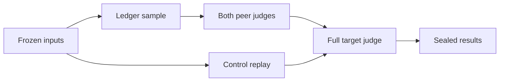

## Summary

Added an opt-in paired replay harness, frozen manifests, a versioned replay ledger,
protocol documentation and native-scorer smoke evidence. Ordinary CLI defaults and
the existing journal record format remain unchanged. Part of #140.

## Spec

### Intent and Rationale

- Compare existing single-enhancement replay with fixed-sample screening, two peer checks and full target confirmation, using the existing engine and acceptance gate.
- Keep the research policy separate from normal population re-entry until representative evidence establishes its value.

### Essential Design Decisions

- Freeze executable and corpus checksums, parent histories, candidate order, explicit sample membership, seeds, thresholds, repetitions and equal per-arm allocations before validation.
- Reuse only measured screen/peer rejections in the exact frozen receiving context. Unresolved samples continue; final target outcomes do not select later candidates.
- Use CPU/MSE with a cleared, fixed-thread scorer environment. Every accepted target passes the existing full `judge()` gate; the harness publishes no population candidate.
- Histories are operator-supplied evidence, checked for overlaps and endpoints; different creature hashes alone do not establish independent ancestry. Smoke receipts are explicitly synthetic.

### Undiscoverable Facts

- The full versioned paper was read through the web reader. Direct downloads returned HTTP 403, so the documented checksum pins extracted text, not original HTML/PDF bytes.
- No representative corpus and independently established receiving-lineage histories were supplied or present in this checkout. The public smoke inputs cannot establish the optimisation hypothesis.
- The native scorer was built from `stSoftwareAU/NEAT-AI-scorer` commit `742c5df30fc98ece3afe784be1aca18f925b47b3`; execution metadata records versions, checksums and the timing boundary.

## Evidence

Backend/CLI only. The ordinary source change adds `Journal::append_entry()` and
routes `append()` through that same writer. Experiment code lives under
`rebase/examples/ledger/` and `rebase/examples/ledger_experiment.rs`.

`docs/ledger-experiment.md` contains the research pin, transfer limits, command,
input formats, protocol, restart semantics and maintenance criteria. README Quick start examples
and the Documentation table link that protocol. The archived
manifest and results are `docs/experiments/ledger-140-smoke-manifest.json` and
`docs/experiments/ledger-140-smoke-results.json`; provenance and timing limitations
are in `docs/experiments/ledger-140-smoke-execution.json`. Raw records are preserved
in `docs/experiments/ledger-140-smoke-ledger.jsonl`; both ledger and manifest
checksums were verified against the execution metadata and results. Regenerate local paths
with `prepare-smoke` rather than executing the path-specific archive unchanged.

Four paired smoke runs used the same parents and two repeated hand-built patches:

| Measurement | Control | Ledger |
| --- | ---: | ---: |
| Scorer calls | 16 | 36 |
| Full target confirmations | 16 | 8 |
| Duplicate screen failures avoided | 0 | 4 |
| Distinct confirmed patch identities across runs | 1 | 1 |
| Scored records | 131,072 | 202,752 |

Both arms completed their workflows without operational failures. Ledger target
coverage was 8/16 attempts versus 16/16 for control. Its descriptive rate-difference
interval was `[-0.024087, -0.019955]` score gain/hour. The complete run command took
5.60 s, excluding separately recorded preparation/freeze. These dev-build timings
came from a shared parallel host; four sample seeds are not four independent
discovery runs. The locked smoke verdict is **inconclusive**, with no representative
benefit established. A completed native run was also successfully resumed.

## Acceptance Criteria

- **missing** — Compare current replay with screening on a fixed cheap sample then two unrelated lineages before full confirmation. — reason: the policy is implemented, but only synthetic receiving parents were available; genuine unrelated-lineage validation remains unperformed.
- **missing** — Predeclare controls, seeds, sample size, compute limits and success/failure criteria. Identify code/model/data versions; separate calibration from untouched validation and count all preparation/search costs. — reason: the frozen protocol and smoke manifest are delivered, but representative calibration and a representative locked manifest do not yet exist.
- **missing** — Deliver a reproducible command/manifest and machine-readable results with paired distributions, uncertainty, failures and actual coverage. Fixtures alone do not demonstrate an optimisation benefit. — reason: reproducible smoke artefacts are delivered; representative paired distributions and coverage remain absent, recorded explicitly in `docs/experiments/ledger-140-availability.json`.
- **missing** — Record negative findings and remove optional code that does not earn its maintenance cost. Do not claim success before representative runs. — reason: smoke results are inconclusive for maintenance; no representative maintenance decision or benefit claim is made.

## Test Plan

- Passed `timeout 1200 ./quality.sh < /dev/null`: shell syntax/ShellCheck, runlib checks, actionlint, cargo-deny, formatting, Clippy, workspace tests and documentation. The experiment suite contains 16 passing tests.
- `rebase/tests/ledger_experiment.rs::paired_replay_preserves_payloads_parents_and_the_full_acceptance_gate` covers payload replay fidelity, immutable parents/payloads, full record coverage, error/complexity deltas and completed restart. Duplicate scope, changed seeds/settings and peer independence have separate behavioural cases in that file.
- The same suite covers unresolved/missing sample scores, missing baseline/candidate results, sampled/non-finite/wrong-coverage full results, operational failures, interrupted-call charging, ledger failures, unknown versions, malformed cached measurements, corpus membership changes, calibration overlap and legacy journal compatibility.
- Tests were written before the new harness implementation; its entry-point test initially failed with `experiment protocol is not implemented`. Missing cached-measurement and corpus-membership guards were also observed failing during development, then fixed. The base branch has no experiment entry point; these are new-feature tests, not claims of a reproduced base-branch bug.
- `rebase/tests/fixtures/ledger-scorer-output.json` records a real native scorer response. `rebase/tests/ledger_experiment.rs::the_strict_parser_accepts_a_recorded_native_scorer_response` checks its numeric results and contract fields; missing-field cases reject rather than applying legacy defaults. The producer's wire contract is in [scoring.rs at the observed commit](https://github.com/stSoftwareAU/NEAT-AI-scorer/blob/742c5df30fc98ece3afe784be1aca18f925b47b3/rust_scorer/src/scoring.rs).
- Existing `rebase/tests/race_conditions.rs` (15 tests) and `rebase/tests/screen_budget.rs` (5 tests) passed, including through the full gate. No existing assertions were removed. Shared rule copies: none changed; classification calls `ScreenVerdict`, acceptance calls `judge`, and both journal interfaces use one writer.
- Markdown lint passed. Security review: scorer arguments use an allowlist and argument APIs, input hashes are checked before/after validation, outputs avoid replacing existing evidence, and no secrets or private data are staged. The harness uses existing crate dependencies.

## Merge verification

CI security checks and external review remain pending. The issue remains open;
representative study work stays within #140.

Not performed: representative calibration/validation and its maintenance decision,
CI security checks, or external review. Risk: ledger-assisted replay may spend more
compute than it saves; synthetic results establish neither representative benefit
nor a representative negative result.
