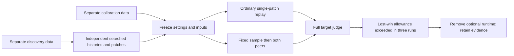

# Replayable ledger experiment: removal decision

The registered real-data comparison returned **remove** in all three independent
discovery runs. The optional fixed-sample/two-peer/cache runtime and its
experiment-only tests have been removed. Ordinary replay, CLI screening,
authoritative acceptance, immutable parents and journal formats retain their
existing behaviour. No experiment policy was enabled by default or deployed.

## Research method and scope

The full versioned [Population Evolution paper](https://arxiv.org/html/2610.05950v1)
was pinned before the original implementation. Its reviewed tool-extracted UTF-8
body has SHA-256 `bc492f7ed3a83a12ba2f610817ab1e7957615cfb730ae195217d2a4ad8836f2e`.
This is not a checksum of the original HTML/PDF. The original extraction covered
web-reader lines 124–1149, removed line-number prefixes, replaced numbered reader
links with their labels, and joined lines with LF and a final LF. Direct downloads
returned HTTP 403; no original-file checksum is claimed.

The method's §§2.2–2.3 and Appendix B distinguish executable interventions from
mechanism descriptions, retain weak peer results, and gate promotion on receiving
instance results. Its decomposed track withholds full-target outcomes from
proposals. Appendix A.7 calibrates references before discovery, while B.5 separates
component searches from complete discovery runs and includes search/evaluation
costs. These requirements informed the frozen comparison; its results are not a
reproduction of the paper's adaptive LLM discovery or cross-scale retraining.

Our interventions were existing v1 Forest patches applied through `rebase()`.
The control replayed each patch alone on a fixed target, through `judge(Full)`.
The assisted arm used a materialised fixed sample, checked **both** unrelated
receiving parents even after one failed, then required the same full target judge.
A sample tie remained unresolved. Only an exact-context measured sample/peer
rejection could avoid a subsequent evaluation; target outcomes were sealed from
candidate selection. Neither arm advanced its parent or published a creature.
The comparison used a fixed finite stream with equal upper allocations, rather
than adaptive search at matched consumed compute.



## Inputs, calibration and predeclaration

The inspected checkouts and working artefact directories supplied no usable
production corpus paired with independent ancestry archives. Instead, the study
used [UCI Wine Quality](https://archive.ics.uci.edu/dataset/186/wine+quality),
Cortez, Cerdeira, Almeida, Matos and Reis (2009), DOI `10.24432/C56S3T`, CC BY 4.0.
The headerless white-data mirror, pinned revision and raw SHA-256 are in the
[preregistration](experiments/ledger-140-preregistration.json).

Deduplication left 3,961 rows: 1,980 discovery, 990 calibration and 991 validation.
SplitMix64 seed 140 shuffled unique numeric rows; column normalisation, including
the target, was fitted on discovery records. The freezer also refused any
byte-identical record crossing calibration and validation. Validation records
were hashed and materialised before scoring, but their outcomes were not used to
choose parents, candidates or thresholds.

Each of three discovery runs independently initialised three receiving parents
and a fourth donor from distinct seeded random 12-hidden-TANH networks. Each
lineage performed six generations of eight residual-stump proposals, selecting
only its best native-scorer improvement. All twelve lineages accepted six steps.
The audit replayed the 72 selected edges against retained snapshots using the
ordinary CLI and verified that all twelve root-to-parent hash lists are disjoint.
Ancestry receipts therefore have executable evidence beyond different final hashes.
They describe shallow custom searches, not production optimisation histories.

Each donor supplied 24 further proposals, retained regardless of source outcome,
then repeated in the same order. Source successes/failures were 14/10, 10/14 and
13/11. Discovery measurements remain in source receipts. Exported envelopes used
neutral zero score claims with the frozen evaluation-corpus identity; those claims
are not represented as source or validation measurements.

The preregistration was committed as `db75e1a` before calibration. Calibration
tried sample counts 32/64/128/256 and margins 1e-8/1e-5/0.001/0.01 using separate
records and seeds 71–74. The smallest sample/margin with no false rejection and a
positive win control was **128 / 0.01**: four calibration target wins and zero
false rejections across those seeds. The complete trial table and setting lock
were committed as `7b26468` before validation; see the
[calibration lock](experiments/ledger-140-calibration-lock.json).

Eight sample seeds, 41–48, were then evaluated per discovery run. These are
**three independent discovery runs and 24 fixed-input sample pairs**, not 24
independent searches. Each arm/seed had limits of 192 calls and 600 seconds,
with a ten-second scorer timeout. Native scorer commit
`742c5df30fc98ece3afe784be1aca18f925b47b3` ran CPU/MSE with a cleared environment
and one activation/file/Rayon thread. Source/toolchain/lock/binary/corpus hashes,
lineage commitments, ordered payload hashes and sample commitments are recorded
in the [machine-readable results](experiments/ledger-140-real-data-results.json).

## Outcomes and maintenance action

| Measurement across 24 pairs | Control | Assisted policy |
| --- | ---: | ---: |
| Completed attempts | 1,152 | 1,152 |
| Native scorer calls | 1,152 | 2,007 |
| Full target evaluations | 1,152 | 28 |
| Confirmed distinct patch observations per sample pair | 56 | 14 |
| Distinct winning identities across discovery runs | 7 | 2 |
| Repeated failed stage evaluations avoided | 0 | 957 |
| Scored records, including baselines | 2,283,264 | 2,213,902 |
| Operational failures / interrupted calls | 0 / 0 | 0 / 0 |
| Outer-inclusive comparison seconds | 244.101 | 259.583 |

Workflow coverage was complete, while assisted full-target coverage was 28/1,152.
The 14 assisted win observations were transferable to both peers and the target;
they concern two distinct patches, with repeat sample observations counted
separately. The 957 avoided evaluations count cached **stage** rejections; a
repeated patch can avoid two peer evaluations.

The policy lost 42 control-confirmed patch observations: 40 at peer gates and two
at the sample gate. Per-run losses over eight seeds were 25, 1 and 16. Five
patches were consistently lost at peer gates; seven distinct patches were lost
in at least one sample pair. The registered allowance was zero. This deterministic
failure establishes the removal decision without relying on shared-host timings.
No acceptance-gate fault was found: the lost wins are the policy's intended
filtering behaviour, not a reason to weaken authoritative acceptance.

The native within-run rate-difference intervals were approximately
`[-3.18420, -3.15024]` and `[-0.44470, -0.42068]` score gain/hour for runs one and
two. Run three made no assisted full-target measurement, so its rate and interval
are **unknown**, not zero. An exact descriptive bootstrap over the two measured
independent-run mean rate differences, including outer residuals, spans
`[-2.74753, -0.33600]`; it excludes the unmeasured third run. Across all three
independent runs, the mean lost-win count per sample pair has a descriptive
bootstrap interval `[0.125, 3.125]`. These small-sample summaries are conditional
on one dataset and do not establish cross-application effect sizes.

The primary denominator covers the complete 503.684-second setup-through-validation
window. It charges 362.304 seconds of initial inspection, retrieval,
source preparation and dev builds, 11.354 seconds of data/search preparation,
1.316 seconds of calibration, and complete freeze/run command times. It includes
sample materialisation, replay, scoring and ledger writes. The outer run commands
took 21.437, 21.420 and 20.228 seconds; outer freeze/run residuals add about 0.226
seconds beyond harness timers. A further 59.710 seconds of inter-command
preparation and bookkeeping is charged from the whole-window clock boundary.
The original frozen native results remain immutable; the public report adds these
outer costs without changing any screening setting or decision. Shared costs are divided equally across runs, seeds and arms. Component timers overlap and must not be summed. Subsequent
ancestry audits, restart checks, correctness tests and report generation are outside this
primary comparison. Timing-receipt writes within that window are included. The
report separately gives its ancestry-audit cost. Timings are indicative, from dev builds on shared host
`vibe-coder-65826`, not a CI gate or a fleet-wide measurement.

Removal deletes the optional example, sample/peer/cache implementation, freezer,
smoke generator and their experiment-only tests/fixture, including the study input
preparer once its evidence was captured. The ordinary journal writer no longer
needs the experimental generic append interface. Neutral receipt auditing and
report generation remain in `scripts/ledger-study-evidence.py`; its small-sample
interval, seed-coverage and cost-reconciliation regression tests are
`scripts/test_ledger_study_evidence.py`.

## Reproduction from the archived source

The complete executable implementation and input preparer remain at source pin
`7b26468e8e70af8597811bef14d6fe1a26e5f683`. Explicitly fetch that pin when using a
shallow checkout. Use a new private worktree and output directory; keep raw data,
creatures, source receipts, path-bearing manifests and ledgers outside this repo.
The current tree intentionally does not build the removed policy.

```bash
# Set these to new private directories. Use gtimeout on macOS.
set -euo pipefail
LEDGER_SETUP_STARTED="$(timeout 5 python3 -c 'import time; print(time.monotonic())')"
export LEDGER_SETUP_STARTED
study_source=/private/ledger-source
scorer_source=/private/scorer-source
study_work=/private/ledger-work
study_target=/private/ledger-target

timeout 60 git fetch origin 7b26468e8e70af8597811bef14d6fe1a26e5f683
timeout 30 git worktree add --detach "$study_source" 7b26468e8e70af8597811bef14d6fe1a26e5f683
timeout 120 gh repo clone stSoftwareAU/NEAT-AI-scorer "$scorer_source"
timeout 60 git -C "$scorer_source" fetch origin 742c5df30fc98ece3afe784be1aca18f925b47b3
timeout 30 git -C "$scorer_source" checkout --detach 742c5df30fc98ece3afe784be1aca18f925b47b3
timeout 5 mkdir "$study_work"
timeout 60 gh api 'repos/jbrownlee/Datasets/contents/winequality-white.csv?ref=d20fcb6402ae34e653d4513b00f39257bb37ed7f' \
  -H 'Accept: application/vnd.github.raw+json' > "$study_work/data.csv"
CARGO_TARGET_DIR="$study_target" timeout 900 cargo build --locked --manifest-path "$study_source/Cargo.toml" --examples --bin neat_ai_rebase < /dev/null
CARGO_TARGET_DIR="$study_target" timeout 900 cargo build --locked --manifest-path "$scorer_source/Cargo.toml" --bin rust_scorer < /dev/null
```

The following Python recipe records elapsed setup costs, including retrieval,
builds and intervening preparation. Run it from the archived worktree with the
setup-start environment variable still set; replace the two private paths.
Do not copy this study's setup duration into another run.
The preparation tool writes calibration/search measurements and drafts but does
not score validation. Each freeze command precedes any validation command.

```python
import datetime, hashlib, json, os, pathlib, subprocess, time
work = pathlib.Path('/private/ledger-work')
binaries = pathlib.Path('/private/ledger-target/debug')
assert hashlib.sha256((work/'data.csv').read_bytes()).hexdigest() == '659d419fff887f225bf977d20520bb64a64cae203e460087f809721d4430ba27'
began_at = datetime.datetime.now(datetime.timezone.utc).isoformat()
setup_seconds = time.monotonic() - float(os.environ['LEDGER_SETUP_STARTED'])
started = time.perf_counter()
subprocess.run([str(binaries/'examples/ledger_study'), str(work/'data.csv'),
                str(binaries/'rust_scorer'), str(work/'study')],
               stdin=subprocess.DEVNULL, check=True, timeout=900)
outer_prepare = time.perf_counter() - started
(work/'prepare-command.json').write_text(json.dumps({
    'seconds': outer_prepare, 'setupSeconds': setup_seconds, 'beganAt': began_at}))
study = work/'study'
prep = json.loads((study/'preparation.json').read_text())
extra = setup_seconds + max(0, outer_prepare-prep['seconds']-prep['calibrationSeconds'])
for number in range(1, 4):
    draft = study/f'run-{number}/draft.json'
    value = json.loads(draft.read_text())
    value['preparationSeconds'] += extra/3
    draft.write_text(json.dumps(value))
commands = []
for phase in ['freeze', 'run']:
    for number in range(1, 4):
        directory = study/f'run-{number}'
        args = ([directory/'draft.json', directory/'manifest.json'] if phase == 'freeze'
                else [directory/'manifest.json', directory/'validation-run'])
        started = time.perf_counter()
        subprocess.run([str(binaries/'examples/ledger_experiment'), phase, *map(str, args)],
                       stdin=subprocess.DEVNULL, stdout=subprocess.DEVNULL,
                       check=True, timeout=900)
        commands.append({'run': number, 'phase': phase,
                         'seconds': time.perf_counter()-started,
                         'completedAt': datetime.datetime.now(datetime.timezone.utc).isoformat()})
        (study/'execution-commands.json').write_text(json.dumps(commands))
```

Run the recipe with stdin redirected from `/dev/null`. Run the current neutral
auditor against those artefacts:

```bash
timeout 120 python3 -B scripts/ledger-study-evidence.py \
  "$study_work/study" "$study_target/debug/neat_ai_rebase" /private/new-results.json < /dev/null
timeout 20 python3 -B scripts/test_ledger_study_evidence.py < /dev/null
```

The auditor creates its output once, verifies frozen input hashes, and dry-replays
accepted ancestry edges. Before processing each run, it requires exactly one pair
for every frozen protocol seed; missing, duplicate or unexpected seeds are
rejected. Allocated outer-inclusive costs must reconcile with the complete
comparison window within one microsecond before any report is written.
The ordinary CLI's `nothingToDo` exit 3 is expected when
checking a final snapshot that already contains its last patch. A completed
historical `run` can also be resumed against the same manifest/output: all three
original completed restarts returned unchanged ledger hashes and no new calls.

The earlier synthetic [smoke manifest](experiments/ledger-140-smoke-manifest.json),
[ledger](experiments/ledger-140-smoke-ledger.jsonl),
[results](experiments/ledger-140-smoke-results.json) and
[execution metadata](experiments/ledger-140-smoke-execution.json) remain historical
execution evidence. Their path-specific inputs are not reusable unchanged, their
settings were uncalibrated, and their hand-built ancestry establishes no benefit.
The real-data comparison supersedes that smoke-only availability assessment; see
[the availability record](experiments/ledger-140-availability.json).

Not measured: production-scale corpora, long-running production optimisers,
adaptive ledger-informed proposal generation, other application datasets or
quiet-host release timings. Those limits do not change the predeclared removal
trigger reached by this study.
