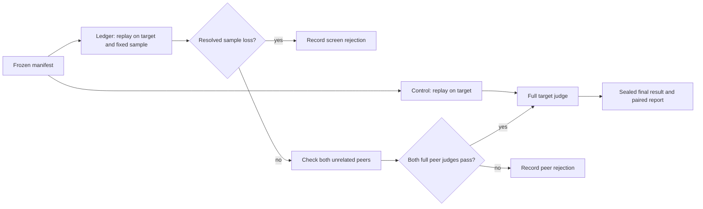

# Replayable ledger experiment

This opt-in harness compares replay policies. It does not change `neat_ai_rebase`,
its default screening policy, enhancement identities, or population publication.
A completed smoke run demonstrates execution, not an optimisation benefit.

## Research pin and transfer limits

The full versioned [Population Evolution paper](https://arxiv.org/html/2610.05950v1)
was reviewed, including §§2–5 and Appendices A–G. The paper shares executable
interventions and their receiving-instance results. Its promotion gates require
peer evidence, with additional intermediate gates in its decomposed track;
that track withholds final-target results from proposals. Baseline calibration
precedes discovery. Its reported complete discovery runs have limited replication.

The pin is `2610.05950v1`. SHA-256
`bc492f7ed3a83a12ba2f610817ab1e7957615cfb730ae195217d2a4ad8836f2e`
identifies the reviewed **tool-extracted UTF-8 body**, not the original HTML or
PDF. Extraction used web-reader lines 124–1149 inclusive, discarded line-number prefixes and their following spaces, replaced `【number†label】` links with `label`, retained other characters,
and joined lines with LF including a final LF. Direct downloads returned HTTP 403;
no original-file checksum is claimed. The paper is not redistributed.

Here the intervention is an existing v1 enhancement replayed by `rebase()` onto
fixed NEAT-AI creatures. There is no LLM proposer, retraining, changing archive,
or cross-scale training. The experiment tests a NEAT-AI transfer hypothesis;
the paper's results do not establish that hypothesis.

## Existing mechanisms and formats

The harness calls `rebase()`, `DirectoryScorer`, `ScreenVerdict::classify`,
`stage()`, `judge()`, and `Journal`. Full peer and target decisions go through
`judge(ScorerMode::Full)`. The ordinary journal's `Record` enum and existing
`append()` interface retain their contracts; `append_entry()` shares the writer
with the separate experimental envelope.

`PatchLog`, `PruneLog`, harvested enhancements, and `EnhancementBundle` already
preserve executable accepted changes. This harness accepts **individual** v1
enhancement files, including repeated paths; extract bundle members without
changing their contents. An experiment attempt records receiving-parent rejection
as well as acceptance. It does not reinterpret a producer's claimed improvement
as an authoritative score.

The NEAT-AI evaluation archive records fitness, descriptors, and parent UUIDs;
its training-gain log records training events. Neither is a portable structural
patch. Preserve those original archives as provenance evidence and file replayable
payloads through this repository's enhancement format. Do not infer independent
ancestry merely from different current creature hashes.

## Freeze before validation

Run from the checkout that builds the example. Paths in a draft are resolved
against the invocation's working directory. Use a private directory outside the
checkout for real corpora, receipts, frozen manifests, ledgers, and results.

1. Establish independent lineage histories from existing run archives. Obtain
   three receiving parents: target at index 0, two peers at indices 1 and 2.
   Supply complete root-to-parent canonical SHA-256 ancestry lists and independently
   established source references. The harness checks asserted histories for
   overlaps and endpoints; it does **not** authenticate those source references
   or reconstruct missing ancestry. A history assertion is not independent evidence.
2. Use calibration records separate from validation to select `sampleCount` and
   `minImprovement`. Save the measurements, selection rationale, and total calibration
   cost in the calibration report. Freeze fixed seeds, candidate order, repetitions,
   budgets, and maintenance criteria before validation. Record prior candidate
   preparation/search time in `preparationSeconds`; zero means no such work occurred.
3. Build once, freeze once, then run the same executable. Freeze refuses an existing
   manifest. A protocol change requires a new manifest and a new output directory.

```bash
cargo build --locked --release --example ledger_experiment
./target/release/examples/ledger_experiment freeze /private/draft.json /private/manifest.json
timeout 900 ./target/release/examples/ledger_experiment run /private/manifest.json /private/run
```

Use the configured Cargo target directory when `CARGO_TARGET_DIR` is set. On
macOS, `gtimeout` can bound the command. The harness requires `timeout` or
`gtimeout` to bound each scorer invocation and kills its process group at the
configured deadline. Standard input is disabled for scorer processes.

A draft has this shape (paths name locally supplied inputs):

```json
{
  "version": 1,
  "evidenceClass": "representative",
  "training": "/private/validation",
  "calibrationTraining": "/private/calibration",
  "calibrationReport": "/private/calibration-report.json",
  "parents": [
    {"creature": "/private/target.json", "provenance": "/private/target-history.json"},
    {"creature": "/private/peer1.json", "provenance": "/private/peer1-history.json"},
    {"creature": "/private/peer2.json", "provenance": "/private/peer2-history.json"}
  ],
  "patches": ["/private/patch1.json", "/private/patch2.json", "/private/patch1.json"],
  "seeds": [41, 42, 43, 44, 45, 46, 47, 48],
  "sampleCount": 4096,
  "minImprovement": 0.00001,
  "scorer": "/private/rust_scorer",
  "scorerArgs": ["--gpu=off", "--cost=MSE"],
  "evaluationTimeoutSeconds": 30,
  "budget": {"calls": 100, "seconds": 600},
  "success": {"minimumPairedRuns": 8, "minimumRateGain": 0.01, "maximumLostWins": 0},
  "preparationSeconds": 0
}
```

These example numbers are **not calibrated recommendations**. `scorerArgs` is
restricted to `--gpu=off` and `--cost=MSE`, preventing flags from silently
turning full confirmation into sampled scoring. No environment-dependent GPU
configuration should be used for the comparison. The scorer receives a cleared
environment with GPU disabled and activation, file-read and Rayon thread counts
fixed to one; these settings are stored in the manifest.

A provenance file contains `completeToRoot: true`,
`establishedBeforeValidation: true`, a non-empty `source` identifying the
independent evidence, the originating `seed`, and `ancestors`: the complete
ordered canonical SHA-256 identities ending with the supplied parent's checksum.
The three lists must be disjoint and each must have at least two entries.
Keep the source evidence available; the frozen file pins the assertion's bytes.

The calibration report contains `sampleCount`, `minImprovement`,
`validationUsed: false`, a non-empty `rationale`, and measured `seconds`.
It must agree with the draft. Retain the underlying calibration measurements
beside the report. Freeze hashes every corpus byte, checks dimensions and record
alignment, and refuses a byte-identical record shared by calibration and validation.
Its full calibration-record hash set uses memory proportional to calibration size.

The frozen manifest records the research pin, runner executable checksum, checkout
revision and dirty state, dependency lock checksum, toolchain configuration,
scorer executable checksum and arguments, corpus file hashes and conventional
corpus identity, parents and histories, payload references, fixed candidate order,
threshold, costs, limits, and explicit sample membership for each seed. SplitMix64
selects unique record indices; membership is materialised verbatim, not delegated
to an implicit scorer sample. The sample can hold at most half the validation corpus.
Seeds select sample membership; they do not seed an adaptive optimiser or scorer.

## Paired policies

Both arms receive the same ordered individual interventions and fixed target.
Each intervention is replayed independently; the target does not advance after
a win. Thus the control is the existing single-enhancement replay path, not a
comparison against the CLI's multi-enhancement bundle/prefix search.



- A sampled tie or absent candidate score is unresolved and proceeds to peers.
  A missing baseline, malformed output, wrong coverage, non-finite measurement,
  or scorer failure is operational failure. Full scoring requires every candidate.
- Each peer is attempted even if the other rejects. Both must pass before target
  confirmation. A peer on which the patch cannot build supplies no passing evidence.
- Failure reuse requires the exact payload bytes, receiving-parent checksum,
  corpus bytes, scorer binary/settings, sample, seed, stage, code, threshold and
  remaining frozen protocol. The manifest hash binds these together. Only measured
  screen/peer rejections are reusable. Final target outcomes do not select subsequent
  patches or populate this cache. Another lineage's rejection never fills this key.
- Arm order alternates by seed. Each arm has the same call allocation and wall-time
  allocation per seed; every scorer call, including a screen, consumes a call.
  Each call reserves its timeout within the remaining allocation. Calls, observed
  elapsed costs and unused/censored coverage are reported rather than equated.

## Ledger, restart and failures

`ledger-v1.jsonl` uses `{"record":"experiment","version":1,"event":...}`.
Evaluation events identify manifest, seed, arm, attempt, stage, enhancement and
executable payload reference, parent/child hashes and changed neuron/synapse IDs.
They carry baseline and child measurements, score/error/complexity deltas, elapsed
time, failure cause, and a source event when reusing a rejection. Missing
measurements are `null`; operational failures are not measured rejections.
Cost events record preparation, arm wall time, and final input verification.

The writer appends and syncs records. An OS file lock excludes simultaneous writers
in one output directory. Completed attempts survive restart; operational failures
are retried and charged. A dispatched call lacking an outcome reserves its full
timeout on restart and makes the result inconclusive. An incomplete final line,
malformed record, unknown version, changed input, or failed journal write fails
loudly. The harness does not truncate or repair evidence automatically.
Legacy ordinary records are retained and ignored as cache evidence; the ordinary
journal reporter can still read those records alongside experimental entries.

`results.json` is created once and returned on a completed restart. Inputs are
checked again before results are saved. No population candidate is published.
Scorer/staging failure exits non-zero; a censored run exits 3 with its report.

## Reporting and maintenance decision

Report per-seed paired distributions, distinct confirmed enhancements, full target
confirmations, transferable wins, duplicate failures avoided, scored records,
unresolved screens, operational failures, interrupted evaluations, coverage, and
stage/component timings. `improvementPerEvaluationHour` is the best non-negative
**measured** target score delta divided by total allocated-to-that-arm observed
hours. Without a full target measurement it is unknown, not zero. This denominator
includes declared preparation/search and calibration, freeze, input verification,
sample preparation, replay, scoring and evaluation-ledger writes. Accounting-record
writes and final result serialisation are outside the timing boundary; use an outer
command timer to record that residual in a representative study.

Uncertainty is a descriptive paired percentile bootstrap of rate differences:
2,000 resamples, seed `0x140`, 95% interval. Its units are score gain/hour. Repeated
sample seeds on fixed parents do not measure variability across independent full
discovery runs. Missing rates are omitted with reduced coverage, not imputed.
Timings from this shared container are indicative and never gate CI.

The locked decision is `retain` only for representative, complete, failure-free
runs meeting `minimumPairedRuns`, the lower interval exceeding the absolute
`minimumRateGain`, and losses of control-confirmed enhancements within
`maximumLostWins`. Exceeding the loss allowance or an interval wholly below zero
returns `remove`. Other outcomes, including `evidenceClass: smoke`, are
`inconclusive`. A `remove` result calls for deleting optional policy mechanisms
before claiming the experiment complete; the harness does not modify its own code.

## Reproducible smoke execution

The fixture generator reuses the existing creature and enhancement constructors.
It creates four paired sample-seed runs over 4,096 records, two hand-built patch
payloads repeated in a fixed stream, and three hand-built receiving creatures.
The root-to-parent receipts describe a synthetic weight change, not independent
evolution. Calibration settings are fixed smoke values with no study behind them.
`evidenceClass: smoke` keeps the maintenance decision inconclusive.

```bash
cargo build --locked --example ledger_experiment
./target/debug/examples/ledger_experiment prepare-smoke /tmp/ledger-smoke /path/to/rust_scorer
./target/debug/examples/ledger_experiment freeze /tmp/ledger-smoke/draft.json /tmp/ledger-smoke/manifest.json
timeout 180 ./target/debug/examples/ledger_experiment run /tmp/ledger-smoke/manifest.json /tmp/ledger-smoke/run
```

The preparation directory must not already exist. Adjust the executable path for
`CARGO_TARGET_DIR`. Rerunning `run` against the same completed directory verifies
inputs and returns its saved results without another scorer call.

## Current evidence and coverage

The repository supplies deterministic correctness fixtures, not established
independent evolved lineages or representative corpora. Their hand-constructed
histories are test inputs, not provenance evidence. No representative benefit or
negative result is established. The public availability record is
[`experiments/ledger-140-availability.json`](experiments/ledger-140-availability.json).
Private data, actual histories and operational integration remain outside this
public repository. Representative paired validation and the maintenance verdict
remain part of the same issue.

The archived [smoke manifest](experiments/ledger-140-smoke-manifest.json),
[paired results](experiments/ledger-140-smoke-results.json),
[raw replay ledger](experiments/ledger-140-smoke-ledger.jsonl), and
[execution metadata](experiments/ledger-140-smoke-execution.json) record a separate
native-scorer execution. It completed four sample-seed pairs with no operational
failures. Across those pairs, ledger replay avoided four duplicate screen failures,
used 36 scorer calls versus control's 16, and confirmed the same enhancement on the
target and both synthetic peers. Full target coverage was 8/16 ledger attempts and
16/16 control attempts; workflow coverage was complete in both arms. The four
transferable-win counts concern the same hand-built patch, not four distinct
scientific discoveries.

Ledger replay performed more scored-record work (202,752 versus 131,072). Its
recorded rate difference interval was negative on these inputs, while its locked
smoke decision remained `inconclusive`. The complete run command took about 5.60 s,
excluding separately recorded preparation and freeze. These are dev-build timings
on a shared parallel host, with fixed parents and patches; they are neither a
representative negative result nor evidence of an optimisation benefit. The
recorded native response in `rebase/tests/fixtures/ledger-scorer-output.json` comes
from the scorer source commit in the execution metadata, using the generated
parent-0 as `baseline` and the full 4,096-record corpus.
